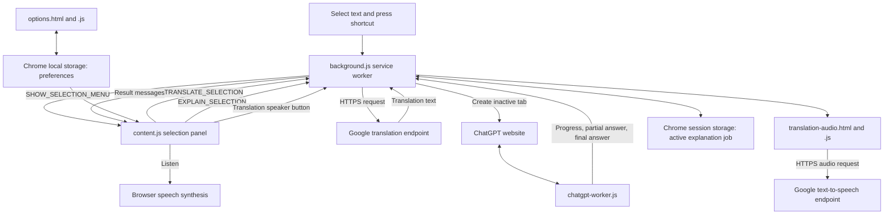

# Word Explainer architecture

This document describes the source currently in `extension/`, version **0.1.5**. It documents implementation and known limitations; it does not certify that every flow has passed an end-to-end browser test.

## Runtime overview

Word Explainer is a Chrome Manifest V3 extension requiring Chrome 116 or later. Its runtime is JavaScript, HTML and CSS. No Python server, local HTTP service, AI API key or separate application backend is required. The former `backend/` directory is absent from the current working tree.

The user selects text on an ordinary web page and explicitly presses a keyboard shortcut. A custom panel appears near the selection with **Listen**, **Ask to ChatGPT** and **Translate** actions. Selecting text alone does not open the panel or send a request.



The panel is inserted into the source page. The ChatGPT website itself is not embedded in an iframe. The toolbar popup, selection panel, inactive ChatGPT tab and offscreen audio document are distinct surfaces.

## Components

Paths below are relative to the project root.

| Component | Responsibility |
|---|---|
| `extension/manifest.json` | Declares version, minimum Chrome version, permissions, content scripts, shortcut, toolbar popup and options page. |
| `extension/content.js` | Reads selections, creates a closed-shadow-root panel, positions it in viewport coordinates, sends action requests, displays progress/results, caches page-local answers and controls pronunciation/translation audio. Its panel CSS is embedded in this file. |
| `extension/background.js` | Receives the shortcut, routes messages, calls Google translation, owns the ChatGPT job/tab lifecycle, handles timeouts and starts the offscreen audio document. |
| `extension/chatgpt-worker.js` | Runs only on `https://chatgpt.com/*`; interacts with a fresh chat composer, submits the prompt once and reads rendered assistant responses. Includes signed-in and signed-out DOM selectors. |
| `extension/translation-audio.html` and `translation-audio.js` | Offscreen extension document that fetches and plays translated-text audio without a visible tab. |
| `extension/options.html`, `options.js`, `options.css` | Preferences form and local persistence. |
| `extension/popup.html`, `popup.js`, `popup.css` | Chrome toolbar popup with usage guidance and a Settings button. It does not display the selection result. |
| `scripts/test-extension.mjs` | Dependency-free Node regression suite using simulated extension APIs and DOM fixtures, including a fixture based on an observed signed-out ChatGPT layout. |
| `scripts/check.py`, `scripts/package.py` | Legacy development/check and ZIP-packaging utilities; neither runs as part of the extension. See the tooling limitation below. |

## Permissions and page coverage

| Manifest entry | Current purpose |
|---|---|
| `storage` | Local preferences and session-scoped explanation-job metadata. |
| `alarms` | Reliable expiration of an explanation job after 150 seconds. |
| `offscreen` | Audio playback in an extension document without a visible tab/window. |
| `https://translate.googleapis.com/*` host permission | Direct Google translation requests from the service worker. |
| `https://translate.google.com/*` host permission | Google text-to-speech requests from the offscreen document. |

`content.js` is statically registered for HTTP/HTTPS pages, with `https://chatgpt.com/*` explicitly excluded. A separate static registration loads `chatgpt-worker.js` there at `document_idle`.

The selection panel operates in the top frame. The manifest does not enable `all_frames`, and messaging targets frame 0. Chrome-protected pages and editable-field selections are unsupported. `contextMenus`, `activeTab`, `scripting` and `tabs` permissions are not declared; right-click actions and programmatic script injection are not part of the current design.

The `show-selection-menu` command defaults to **Command+Shift+Y** on macOS and **Ctrl+Shift+Y** elsewhere. Users can change its binding at `chrome://extensions/shortcuts`.

## Action flows

### Show the selection panel

1. The command wakes `background.js`, which sends `SHOW_SELECTION_MENU` to the active tab's top frame.
2. `content.js` rejects selections in inputs, textareas or editable content, reads `window.getSelection()` and takes at most 1,000 characters.
3. It uses the selection range's rectangle to position the panel above the selection where space permits, otherwise below, clamped to the viewport.
4. Escape, an outside mouse release, page scrolling or window resizing hides the panel. Hiding does not cancel an explanation already in progress, but it stops translation audio.

### Listen to the selected text

The top-level **Listen** button uses `SpeechSynthesisUtterance` in the source page with the configured pronunciation language and rate. Voice availability depends on the browser/device. This action reads the original selection, not the translated result.

### Translate with Google

1. Clicking **Translate** sends `TRANSLATE_SELECTION`, selected text, target language, request ID and build ID to the service worker.
2. The service worker validates the request and acknowledges it immediately.
3. It makes a GET request to `https://translate.googleapis.com/translate_a/single` with `client=gtx`, source-language autodetection, target-language code and selected text in the query string. Credentials are omitted, redirects rejected and the request is aborted after 15 seconds.
4. Translation segments from the JSON response are joined and sent back through `EXPLANATION_RESULT`. Despite that shared message name, this path does not call ChatGPT or open a tab.
5. The source panel displays the translation with automatic text direction and a configurable font size. Errors, empty/malformed responses, connection failures and rate limiting produce an error result.

Supported targets are Urdu (`ur`), English (`en`), Arabic (`ar`), French (`fr`) and Spanish (`es`). Urdu is the default.

### Ask ChatGPT for an explanation

1. Clicking **Ask to ChatGPT** sends `EXPLAIN_SELECTION` with a unique request ID and build ID. Request acknowledgement is separate from the eventual answer.
2. The service worker permits one active explanation job at a time and creates a new `https://chatgpt.com/` tab with `active: false`. It does not reuse an existing user tab. The new tab can still appear in the tab strip.
3. It saves job metadata in `chrome.storage.session` and schedules a 150-second expiration alarm. It waits up to 30 seconds for the ChatGPT worker's readiness/build handshake.
4. The prompt requests 3–4 short sentences, at most 60 words. This is an instruction to the model, not an enforced line-count guarantee.
5. The ChatGPT worker waits for the composer, switches from Work to Chat when the corresponding control is available, refuses to submit into an existing conversation, fills the editor and clicks Send once.
6. Before submission it persists the `submitted` phase. If the ChatGPT document reloads, the replacement worker uses `CHATGPT_RESUME` to resume reading rather than resubmitting.
7. Progress, partial text and final text are sent as separate messages. The service worker forwards them to the source tab with its request ID, avoiding a message channel held open for the whole generation.
8. The worker uses rendered assistant-message text, excludes empty trailing placeholders, and treats a stable answer with no visible Stop control as complete. Readiness, send and answer waits are bounded; final answer text is capped at 2,000 characters.
9. Success, failure, timeout or source/owned-tab closure triggers job cleanup. Cleanup removes session metadata, clears the alarm, forwards a final result where possible and closes only the extension-created ChatGPT tab.

ChatGPT uses the browser profile's existing website session, or its guest experience when available. The extension does not read cookies, extract login tokens or use the OpenAI API. Sign-in requirements, verification, usage limits, background-tab behavior and website DOM changes can interrupt this flow; they are not bypassed.

### Read the translation aloud

1. A successful translation exposes a speaker button beside the result status. It reads the translated text in the selected target language, Urdu by default.
2. `SPEAK_TRANSLATION` asks the service worker to create or reuse the offscreen document with the `AUDIO_PLAYBACK` reason.
3. The document splits text into chunks of at most 180 Unicode code points and fetches audio from `https://translate.google.com/translate_tts` using `client=tw-ob`, the target-language code and chunk text. Credentials are omitted and each request has a 15-second timeout.
4. Audio blobs play sequentially through `Audio` objects at the configured speaking rate. Blob URLs are revoked after use.
5. Playback status returns through `TRANSLATION_AUDIO_STATUS` and `TRANSLATION_SPEECH_STATUS`. Clicking the speaker again, hiding the panel or starting another action stops playback. Errors appear beside the result.

This path does not depend on an installed Urdu system voice and creates no visible browser tab. Chrome may close the offscreen document after 30 seconds without audio playback; the service worker recreates it when required.

## State and settings

| State | Location and lifetime |
|---|---|
| Pronunciation language (`en-US`), rate (`1`), translation target (`Urdu`), translation font size (`20`) | `chrome.storage.local`; read by the source panel and updated live through storage-change events. Translation size is clamped to 14–32 pixels. |
| Explanation detail (`detailed`) | Saved by the options page, but the current explanation prompt does **not** consume this preference; it always requests a short answer. |
| Active explanation job | `chrome.storage.session` under `activeExplanationJob`: owned/source tab IDs, request ID, phase and expiration time. This allows recovery across service-worker suspension. |
| Pending requests and answer cache | In-memory maps in each source page. At most 20 completed results, including errors, are retained; keys distinguish text, action and translation language. A page refresh clears them. |
| Translation cancellation controllers | Service-worker memory only; each request has its own 15-second timeout. |
| Audio playback | Offscreen-document memory; requests accept at most 5,000 text characters and clamp rate to 0.5–2. |

The panel currently has **one shared result area**. Translation and explanation are cached separately, but starting one replaces the visible result of the other. Two simultaneously visible result sections are not implemented. There is no persistent word history, saved-word list, quiz or follow-up chat UI.

## Messaging and lifecycle safeguards

- Messages are checked against the extension ID; ChatGPT progress/results are associated with the stored owned-tab ID.
- Source requests, background code and the ChatGPT readiness handshake use build ID `0.1.5`. A mismatched build produces a refresh instruction. Release changes must keep the manifest version, three JavaScript build constants and panel version label consistent.
- Long-running work uses immediate acknowledgements plus separate progress/result messages. Only short metadata reads/writes retain asynchronous response callbacks.
- The ChatGPT worker guards against synchronous runtime failures and rejected message promises after an extension reload, stops its heartbeat, and disposes on `pagehide`.
- Completed source-page results are rendered with `textContent`; returned provider text is not inserted as HTML.
- Reloading an unpacked extension does not replace scripts already running in open web pages. Refresh source pages and close old extension-created ChatGPT tabs after an update.

## External-service and data boundaries

| Service | Data sent | Integration |
|---|---|---|
| Google translation | Selected text and target language | Direct HTTPS GET from the service worker; no API key or cookies. |
| Google speech | Translated text chunks and language | HTTPS GET from the offscreen document; no API key or cookies. |
| ChatGPT website | Selected text inside an explanation prompt | Browser UI automation in a newly created inactive tab; normal website authentication/guest access applies. |

Both Google URLs are undocumented web endpoints, not a configured Google Cloud Translation API integration. Their format, availability or rate limits can change. The ChatGPT integration likewise depends on website UI structure and is not an official API integration. No backend fallback is configured.

Only selected text is sent for translation/explanation; surrounding page paragraphs are not automatically added as context. Translation audio sends the translated result only when its speaker button is clicked. Request text travels in query parameters for the Google endpoints; there is no extension-managed persistent history of selected words.

## Setup and verification

1. Use Chrome 116 or newer. Open `chrome://extensions`, enable Developer mode and choose **Load unpacked**.
2. Select the project's `extension/` directory—the directory containing `manifest.json`, not the project root.
3. Refresh an ordinary HTTP/HTTPS page, select text and press the configured shortcut. The selection panel is intentionally excluded from ChatGPT itself.
4. Open settings through the panel's gear button or the toolbar popup's Settings button. Save translation language, text size and speaking preferences as needed.
5. After changes, reload the extension and refresh source pages. Recheck the shortcut binding if it does not trigger.

Run the JavaScript regression suite from the project root with Node.js:

```sh
node scripts/test-extension.mjs
```

The suite checks syntax, simulated messaging/tab lifecycle, context invalidation, observed guest-layout fixtures, direct translation routing, font settings and audio handling. It does not execute a real unpacked extension inside Chrome. Manual checks remain necessary for shortcut registration, site access, real ChatGPT responses and actual audio playback.

**Known tooling inconsistency:** `scripts/check.py` still attempts to discover tests inside the absent `backend/` directory, and `.github/workflows/checks.yml` invokes that script. The legacy check/CI path therefore needs a separate cleanup. `scripts/package.py` can create `dist/word-explainer-extension.zip`; that output directory is optional and is not needed to load the extension.

The latest reported issue is that the extension stopped working after recent changes. This document records current source behavior and does not claim that runtime issue has been resolved.
